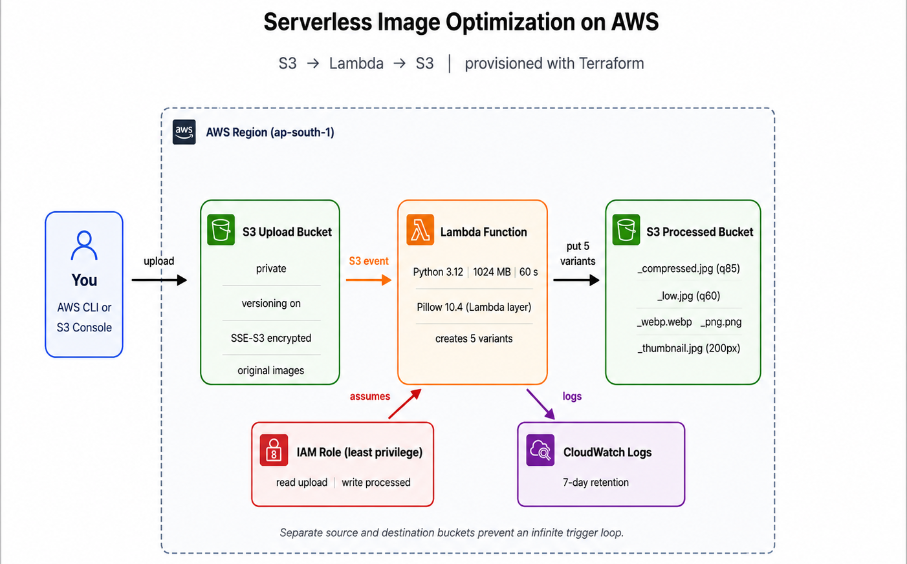
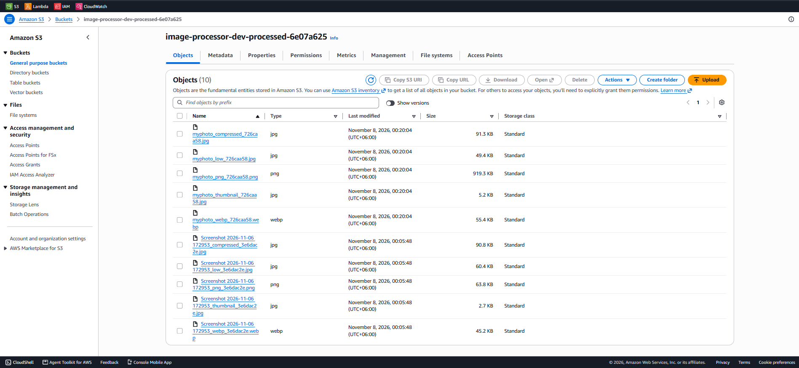
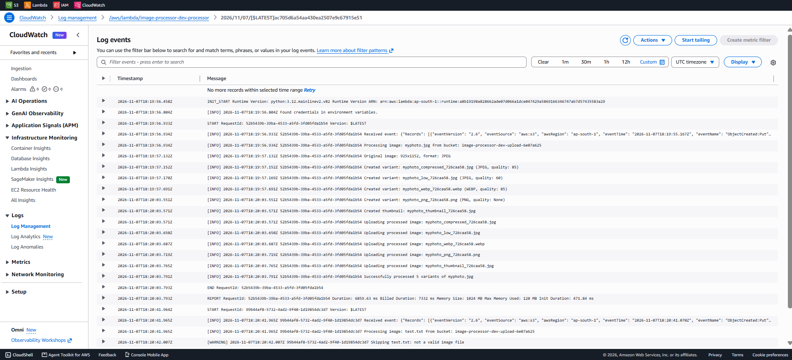

# 🖼️ Serverless Image Optimization

A lightweight, fully automated **AWS serverless image optimization pipeline**. Upload an image to Amazon S3 and AWS Lambda automatically creates **5 optimized variants** in a second bucket. All infrastructure is defined with **Terraform**.

> Built as part of the **#30DaysOfAWSTerraform** challenge (Day 18).

## 🏗️ Architecture



**Flow:** upload image → S3 `ObjectCreated` event → Lambda (Python + Pillow layer) → 5 variants written to the processed bucket → logs go to CloudWatch.

Two separate buckets are used on purpose, so Lambda's output can never re-trigger Lambda (no infinite loop).

## ✨ Features

- **Automated processing** – S3 events trigger Lambda automatically
- **JPEG compression** – optimized images at 85% and 60% quality
- **WebP conversion** – modern format with efficient compression
- **PNG conversion** – lossless output
- **Thumbnail generation** – previews up to 200 × 200 px (aspect ratio kept)
- **Smart handling** – EXIF rotation for phone photos, transparency flattened for JPEG, spaces in filenames, very large images downscaled, non-image files skipped safely
- **Serverless** – no servers to manage
- **Infrastructure as Code** – everything provisioned with Terraform

## ⚙️ Tech Stack

| Technology | Purpose |
|---|---|
| AWS S3 | Image storage (private, versioned, encrypted) |
| AWS Lambda (Python 3.12) | Image processing |
| Lambda Layer | Pillow 10.4.0 dependency |
| AWS IAM | Least-privilege access |
| AWS CloudWatch | Logs and monitoring |
| Terraform | Infrastructure provisioning |
| Docker (optional) | Builds the Linux-compatible layer |

## 📦 Generated Outputs

Each uploaded image produces five variants:

| Variant | Configuration |
|---|---|
| `_compressed` | JPEG, 85% quality |
| `_low` | JPEG, 60% quality |
| `_webp` | WebP, 85% quality |
| `_png` | PNG, lossless |
| `_thumbnail` | JPEG, max 200 × 200 px |

## 🚀 Deployment

**Prerequisites:** AWS account, [AWS CLI v2](https://aws.amazon.com/cli/), [Terraform ≥ 1.0](https://developer.hashicorp.com/terraform/install), Python 3. Docker is optional (a pip fallback builds the layer). On Windows, use **Git Bash**.

```bash
git clone <repository-url>
cd <project-directory>

aws configure                    # set access keys and region
aws sts get-caller-identity      # verify the connection

cp terraform/terraform.tfvars.example terraform/terraform.tfvars   # edit the region if needed

chmod +x scripts/*.sh
./scripts/deploy.sh
```

The script builds the Pillow layer for Linux x86_64, then runs `terraform init`, `plan` and `apply`, and prints your bucket names.

## 📸 Usage

```bash
# Get bucket names
cd terraform
UPLOAD=$(terraform output -raw upload_bucket_name)
PROCESSED=$(terraform output -raw processed_bucket_name)

# Upload an image
aws s3 cp my-photo.jpg s3://$UPLOAD/

# List processed images
aws s3 ls s3://$PROCESSED/ --recursive

# Download a processed image
aws s3 cp s3://$PROCESSED/<filename> ./
```

## ✅ Verified Results

Tested end to end in `ap-south-1` (Mumbai).

**Processed bucket** – 5 variants per uploaded image (10 objects for 2 images):



**CloudWatch logs** – the full run from `Processing image` to `Successfully processed 5 variants`:



| Test input | Duration | Memory used | Result |
|---|---|---|---|
| 1917×900 PNG screenshot | 1.3 s (+0.6 s cold start) | 129 MB | 5 variants |
| 925×1152 JPG photo | 6.9 s | 120 MB | 5 variants |
| `test.txt` | 45 ms | 120 MB | Skipped with a warning, no error |

For the photo, PNG was the largest variant (about 919 KB vs 91 KB JPEG and 55 KB WebP), which shows why WebP and JPEG are better for the web.

## 📊 Monitoring

```bash
# Windows Git Bash needs MSYS_NO_PATHCONV=1 for paths starting with /
MSYS_NO_PATHCONV=1 aws logs tail /aws/lambda/serverless-image-optimization-dev-processor --since 10m
```

CloudWatch shows Lambda logs, invocations, duration and errors (Lambda → Monitor tab).

## 🔐 Security

- Private S3 buckets with all public access blocked
- Server-side encryption (SSE-S3) and versioning
- Least-privilege IAM: read only from the upload bucket, write only to the processed bucket
- No credentials in the code or the repository

## 🧠 Lessons Learned

- The Lambda layer must be built for **Linux x86_64**, not for your laptop.
- Separate source and destination buckets prevent recursive triggers.
- Lambda errors should be raised, not swallowed, so failures show up in metrics.
- PNG `optimize=True` is slow on large images. The photo test showed about 6 s for the PNG step alone, so very large images need a higher timeout or a lower PNG compression level.
- Cold starts (about 0.5 s here) only affect the first invocation after idle time.

## 🧹 Cleanup

```bash
./scripts/destroy.sh
```

Buckets use `force_destroy = true`, so Terraform empties them (including all versions) and removes everything.

## 📁 Project Structure

```text
.
├── lambda/lambda_function.py        # image processing code
├── terraform/                       # all infrastructure
├── scripts/
│   ├── deploy.sh                    # build layer + terraform apply
│   ├── destroy.sh                   # terraform destroy
│   ├── build_layer_docker.sh        # Pillow layer via Docker
│   └── build_layer_pip.py           # Pillow layer without Docker
└── docs/images/                     # README screenshots
```

## 🎯 Project Goals

- Automate image processing with an event-driven architecture
- Explore AWS Lambda and S3 integration
- Implement serverless infrastructure with Terraform
- Generate optimized image formats without maintaining servers

---

**Built with Python, AWS Lambda, Amazon S3, and Terraform.**
